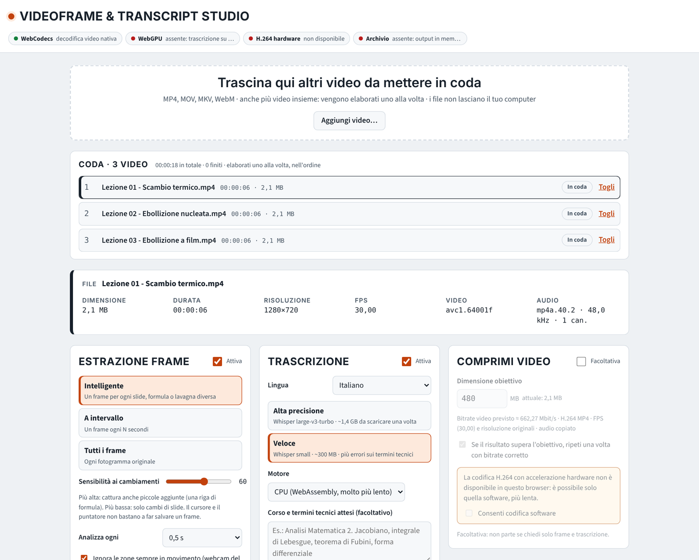

# VideoFrame & Transcript Studio

**Turn hours of recorded lectures into slides and searchable text, entirely in your browser.**

Drop one or more lecture recordings (even 1+ GB each) and get, for every video:

- **`FRAMES.zip`**: the frames, in order, with a CSV index of exact timestamps. A "smart" mode saves one image per slide, formula or whiteboard state and ignores the cursor and the presenter's webcam.
- **`TRASCRIZIONE.txt`**: a full transcript made with OpenAI Whisper running locally on the GPU (WebGPU), plus optional `.srt` subtitles.
- **`VIDEO_COMPRESSO.mp4`** (optional): H.264 compressed to a target size, with the same FPS, resolution and untouched audio.

Nothing is uploaded: the video never leaves the computer. There is no server, no account and nothing to install.



> The interface is in Italian: it was built for Italian university students.

## Try it

- **Online:** https://giovannibishara.github.io/VideoFrameStudio/ (Chrome or Edge on desktop)
- **Offline, single file:** download [`VideoFrameStudio.html`](https://giovannibishara.github.io/VideoFrameStudio/VideoFrameStudio.html) and open it with a double click. When opened from disk, the app asks for a folder and saves the results there as they are produced.

The first transcription downloads the Whisper model once (about 1.4 GB for "Alta precisione", about 300 MB for "Veloce"). After that the model stays in the browser cache.

## Highlights

**Built for multi-hour, multi-gigabyte files**
- The video is read in chunks through Mediabunny's `BlobSource`, so it is never loaded fully into RAM.
- Decoded audio is held in a bounded buffer: at most 10 minutes ahead (about 38 MB).
- Results are streamed to disk through the Origin Private File System or a user-chosen folder (File System Access API).
- The ZIP writer is custom and supports ZIP64, so archives can exceed 4 GB and hold more than 65,535 files. It is tested against Python's `zipfile` and `unzip`.

**Transcription that does not silently lose speech**
- **Seek-based windowing, as in OpenAI's reference implementation.** A sentence cut at the end of a 30 s window is re-read from its start in the next window, so sentences are never split or duplicated.
- **Two decoding rules from the original Whisper, re-implemented as custom logits processors.** Transformers.js 4.3.2 does not enforce them:
  - the first timestamp of a window must fall within 1 s;
  - timestamps must never go backwards.
- **Temperature fallback (0 → 0.2 → 0.4).** A window is redone when the text repeats itself (gzip compression ratio > 2.4), echoes the prompt, or has low average log-probability (< −1).
- **Second pass on skipped speech.** Spans with clear speech energy but no text are re-transcribed on their own and merged back in place, with exact timestamps.
- **Nothing is hidden.**
  - Audio that cannot be transcribed is marked `[PARTE NON TRASCRITTA …]` and the file is named `TRASCRIZIONE_INCOMPLETA.txt`.
  - Uncertain windows are flagged in the preview and counted in the summary.
- **Domain vocabulary.** A course and terminology field is passed to Whisper as its native initial prompt (`<|startofprev|>`), so technical terms are spelled correctly.

**Performance without trading accuracy**
- Frames, transcription and compression run in separate Web Workers. JPEG/PNG encoding is spread over several cores with `OffscreenCanvas`.
- Video decoding (WebCodecs) and Whisper (WebGPU) run in parallel, because they use different parts of the GPU.
- When a window is retried, the Whisper encoder output is computed once and reused. This saves the heaviest part of a retry and produces the same text.
- In a queue, the loaded model is kept between videos.
- The log reports where time goes: first pass, retries, second pass, waiting for audio, encoder vs. token generation, and real-time speed every 10 minutes.

**Smart frame extraction**
- Each frame is reduced to a 320×180 grayscale thumbnail split into 10×10 blocks. A frame is saved when enough blocks change and the content has settled.
- A moving cursor touches too few blocks to trigger a save.
- Regions that change all the time, such as a Webex webcam or an embedded video, are detected and excluded.
- Before each change, the final state is saved too, for example a full whiteboard just before it is erased.

**Queue of videos.** Drop a whole course at once. Videos are processed one at a time and each gets its own sub-folder. While the tab is visible, a Wake Lock keeps the PC from sleeping.

## Architecture

```
src/
├── main.tsx                  React UI: queue, options, progress, downloads
├── app/system.ts             capability checks (WebCodecs, WebGPU, OPFS), probing, downloads, wake lock
├── workerUrls.ts             workers as module files (site) or inlined blobs (single-file build)
├── workers/
│   ├── frames.worker.ts      decode → select frames → encode in parallel → streaming ZIP
│   ├── encoder.worker.ts     JPEG/PNG encoding with OffscreenCanvas
│   ├── transcribe.worker.ts  audio decode → 16 kHz mono → Whisper (Transformers.js, WebGPU/WASM)
│   └── compress.worker.ts    H.264 re-encode to a target size (Mediabunny Conversion)
└── shared/
    ├── transcribeCore.ts     model-independent windowing, retries, second pass, gap accounting
    ├── whisperRules.ts       timestamp rules and log-probability tracking (logits processors)
    ├── smart.ts              slide/whiteboard change detection
    ├── zip.ts                streaming ZIP/ZIP64 writer with CRC-32
    ├── resample.ts           streaming anti-aliased resampler
    ├── transcriptText.ts     paragraphs, timestamps, SRT
    └── outfile.ts            OPFS / folder / in-memory output files
```

| Concern | Technology |
|---|---|
| Container parsing and decoding (MP4, MOV, MKV, WebM) | [Mediabunny](https://mediabunny.dev) 1.65 on top of WebCodecs |
| Speech recognition | [Transformers.js](https://github.com/huggingface/transformers.js) 4.3.2 with `whisper-large-v3-turbo` or `whisper-small` (ONNX), WebGPU with WebAssembly fallback |
| UI | React 19, plain CSS, light and dark themes |
| Build | esbuild: a static site plus a single self-contained HTML file with inlined workers |

## Development

```bash
npm install
npm run dev            # http://localhost:5173
npm run typecheck
npm test               # unit tests (Node)
npm run build          # dist/: static site
npm run build:single   # dist-single/VideoFrameStudio.html
```

### Tests

The unit tests cover:
- ZIP/ZIP64 output, checked with Python's `zipfile` and `unzip`;
- the resampler;
- slide and whiteboard detection;
- transcript formatting;
- the transcription pipeline.

Testing the transcription pipeline does not need the real model. A simulated recognizer "hears" synthetic tones as numbered sentences, which makes completeness, order and timestamps checkable exactly. On a 40-minute synthetic lecture with a 2-minute pause, every sentence appears once, in order, with timestamps within 60 ms. Further tests force the model to fail in specific ways and check how the pipeline reacts:

| Simulated failure | What the tests check |
|---|---|
| Wrong, low-confidence text at temperature 0 | The window is retried at 0.2 and the confident text is kept |
| Low confidence on every attempt | The text is kept and flagged for review, never dropped |
| One sentence skipped per window | Every skipped sentence is recovered by the second pass, with exact timestamps |
| The model fails 4 times on one window | The gap is declared in the text and the transcript is marked incomplete |

The end-to-end tests run in headless Chrome with Playwright. They load generated videos whose frames carry their own number, run the real UI and verify every output file. They need Python 3 with Pillow, ffmpeg, Chrome and Playwright:

```bash
python3 tests/make_test_videos.py ./test-videos 20
npm run build:test && (cd dist-test && python3 -m http.server 8123) &
node tests/browser.test.mjs "http://127.0.0.1:8123/?test-asr" test-videos/breve.mp4 out all
python3 tests/verify.py test-videos/breve.mp4 out all 5
```

The test build contains the simulated recognizer. The build fails if that code ever ends up in a published bundle.

## Known limits

- Whisper speed depends on the GPU. Without WebGPU, transcription runs on the CPU and is much slower.
- Integrated GPUs work, but a discrete GPU is many times faster.
- The size of the compressed video depends on the hardware encoder. If the encoder overshoots the target, the app says so and can retry once with a corrected bitrate.

## License

MIT © Giovanni Bishara. Mediabunny is MPL-2.0. The Whisper models are released by OpenAI under the MIT license.
