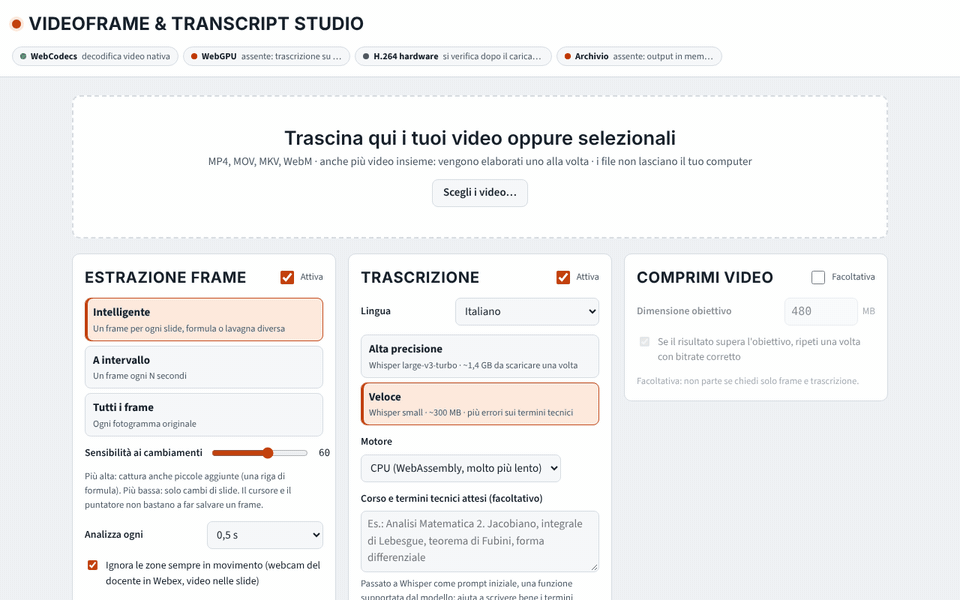

**Slides and a full transcript from hours of recorded lectures, entirely in your browser.**

Drop one or more lecture recordings. For each one you get:
- `FRAMES.zip`: one image per slide or whiteboard state;
- `TRASCRIZIONE.txt`: the full transcript, made by Whisper on your GPU;
- optionally, a compressed copy of the video.

Nothing is uploaded.

**New in this version**
- **The transcription does not silently lose speech.** The app now:
  - enforces Whisper's original timestamp rules;
  - retries uncertain windows at a higher temperature;
  - runs a second pass on spans with speech but no text;
  - flags what is still uncertain.
- **A queue of videos.** Drop a whole course: videos are processed one at a time, each in its own folder, with the model loaded only once.
- **Timing in the log**, and encoder reuse on retries, which is faster and gives identical text.

### Use it

| | |
| --- | --- |
| **Online** | https://giovannibishara.github.io/VideoFrameStudio/ (Chrome or Edge) |
| **Single file** | `VideoFrameStudio.html`: download, then open with a double click |
| **Your own site** | `VideoFrameStudio-sito.zip`: a static site for any HTTPS host |

The files are attached a few minutes after the release is published. They are built by GitHub Actions from this exact source, and `SHA256SUMS.txt` lets you verify them (`Get-FileHash VideoFrameStudio.html` on Windows).

The first transcription downloads the Whisper model once (about 1.4 GB, or 300 MB for the fast model).

See the [README](https://github.com/GiovanniBishara/VideoFrameStudio#readme) for how it works, and the [CHANGELOG](https://github.com/GiovanniBishara/VideoFrameStudio/blob/main/CHANGELOG.md) for every change.
